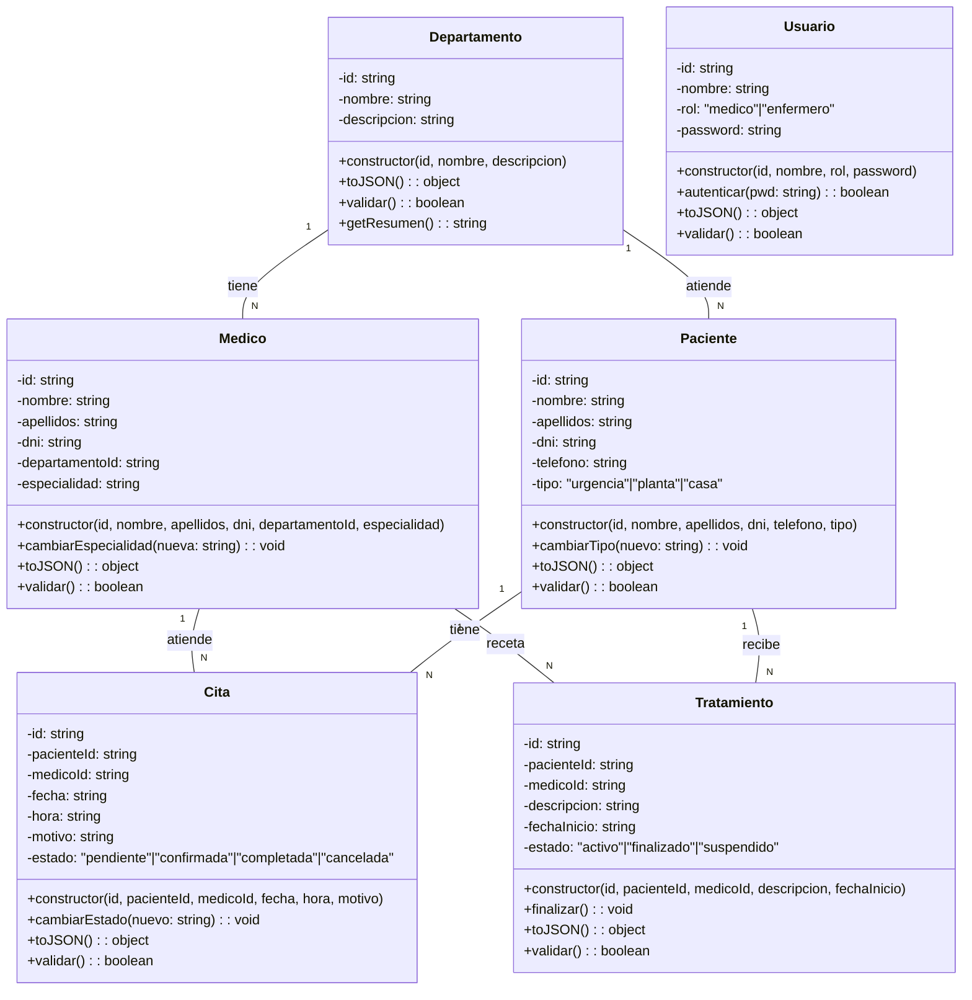
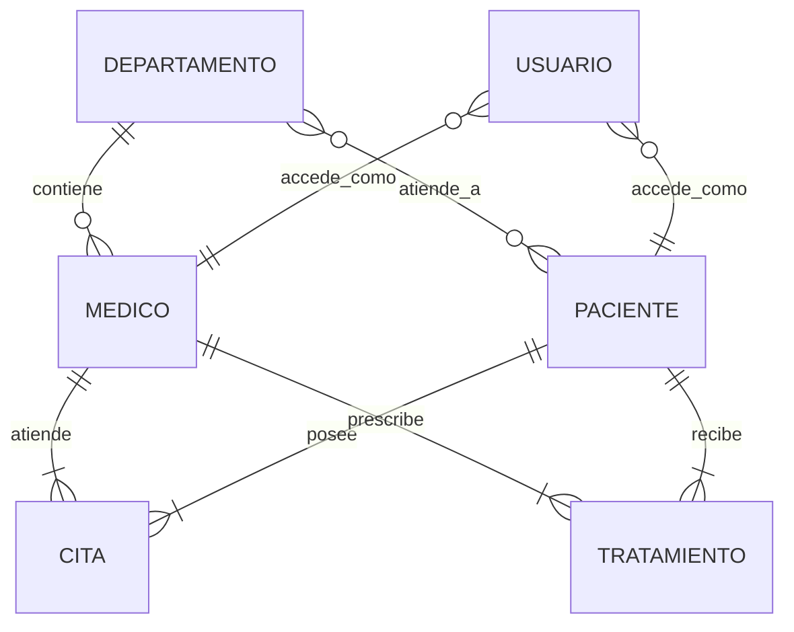

# HCRUDA — Modelo de datos, clases y relaciones

> Todos los `.md` del proyecto viven en `.env/`. Este archivo es la referencia de estructura antes de escribir JS.

## 1. Almacenamiento (sin base de datos real)

- No hay servidor SQL ni BD persistente.
- Los datos iniciales ("semilla") viven en **archivos JSON en `json/`**.
- Al cargar la app, esos JSON se leen y se instancian como **objetos JS en memoria**.
- La sesión del usuario y los cambios del CRUD se guardan en `localStorage` / `cookies` (req. de la entrega).
- Al recargar, se vuelve a leer `json/` (o `localStorage` si hay cambios pendientes).

## 2. Clases JS propuestas (mínimas, ≥5 campos, constructor y ≥3 métodos)

| Clase | Campos mínimos | Relación clave |
|-------|---------------|----------------|
| **Departamento** | id, nombre, descripcion | 1:N con Médico; N:M con Paciente |
| **Medico** | id, nombre, apellidos, dni, departamentoId, especialidad | N:1 con Departamento |
| **Paciente** | id, nombre, apellidos, dni, telefono, tipo ("urgencia" \| "planta" \| "casa") | N:M con Departamento; 1:N con Cita/Tratamiento |
| **Cita** | id, pacienteId, medicoId, fecha, hora, motivo, estado | N:1 con Medico; N:1 con Paciente |
| **Tratamiento** | id, pacienteId, medicoId, descripcion, fechaInicio, estado | N:1 con Medico; N:1 con Paciente |
| **Usuario** (login) | id, nombre, rol ("medico" \| "enfermero"), password | acceso al sistema |

> Cada clase debe tener constructor y al menos 3 métodos propios (ej. `validar()`, `toJSON()`, `cambiarEstado()`, `getResumen()`…). Esto cubre RA4 (objetos definidos por el usuario).

## 3. Relaciones

- Un **Médico** pertenece a **1 Departamento**.
- Un **Departamento** tiene **N Médicos** y **N Pacientes**.
- Un **Paciente** puede estar en **1 o más Departamentos**.
- Una **Cita** tiene **1 Médico** y **1 Paciente**.
- Un **Tratamiento** tiene **1 Médico** y **1 Paciente**.

## 4. Diagrama de clases (Mermaid)

## 5. Diagrama entidad-relación (Mermaid)

## 6. Archivos JSON iniciales en `json/`

| Archivo | Contenido | Uso |
|---------|-----------|-----|
| `departamentos.json` | Lista de departamentos | Carga inicial (seed) |
| `medicos.json` | Lista de médicos con `departamentoId` | Carga inicial (seed) |
| `pacientes.json` | Lista de pacientes con `tipo` | Carga inicial (seed) |
| `citas.json` | Lista de citas con `pacienteId` y `medicoId` | Carga inicial (seed) |
| `tratamientos.json` | Lista de tratamientos | Carga inicial (seed) |
| `usuarios.json` | Usuarios de login (rol médico/enfermero) | Carga inicial (seed) |

> Estos JSON simulan lo que vendría de SQL/servidor. Al arrancar la app se leen mediante `fetch` o archivo JS adicional (req. de carga inicial).

## 7. Qué va en JSON, en objetos JS y en ambos

| Capa | Qué va | Ejemplo |
|------|--------|---------|
| **JSON** (`json/`) | Datos crudos de carga inicial. Estructura plana, sin métodos. | `{ "id": "1", "nombre": "Cardiología", ... }` |
| **Objeto JS** | Instancias de clase con constructor, métodos y lógica de negocio. CRUD en memoria, validaciones, eventos DOM. | `new Departamento(id, nombre, descripcion)` |
| **Ambos** | Flujo normal: JSON → `fetch` → `new Clase(datos)` → array/Maps en JS → cambios se guardan en `localStorage`. | Cita cargada desde JSON, modificada en JS, guardada en storage |

**Regla:** la mayoría de entidades están en **ambos** (origen en JSON, vida en JS). Solo los datos de sesión/login y los cambios del CRUD en curso son exclusivos de `localStorage`/`cookies` hasta que se decida persistir de nuevo.

## 8. Objetos mínimos a crear al arranque (seed)

Para no partir del sistema vacío (req. de entrega), instanciar al menos:

- 3 Departamentos
- 5 Médicos (distribuidos en departamentos)
- 8 Pacientes (mezcla urgencia/planta/casa)
- 6 Citas (vinculando pacientes y médicos)
- 4 Tratamientos
- 2 Usuarios (1 médico, 1 enfermero) para login

## 9. Relación con criterios de evaluación (HCRUDA_PROJECT.md)

- **RA2 (sintaxis):** nombres de variables/métodos claros, comentarios, indexación.
- **RA3 (objetos predefinidos):** uso de `Array`, `Map`, `Date`, `JSON`, `localStorage`, `setInterval`/`setTimeout`.
- **RA4 (clases/colecciones):** las 6 clases anteriores con constructor + ≥3 métodos cada una; CRUD con colecciones (arrays/Maps).
- **RA5 (interacción):** formularios de login/registro con validación regex, eventos `click`/`keypress`, menú como Web Component.
